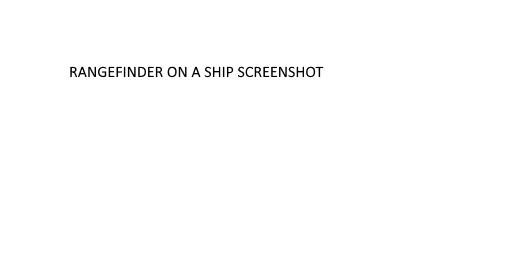

# Create: Danger Close

**Create Danger Close** is an addon for Create, Create Simulated (Aeronautics) and Create Big Cannons, centered around pre-radar era gunnery.

## Contents

Create Danger Close (CDC) implements the following gameplay mechanics:

* Mechanical connectivity: no magical wireless linking. All components require connection to a shared Create kinetic network (Battle Network) to see each other and work together.
* Modular multiblock Ballistic computers: from simple static-target fire missions to ship combat with lead and attitude corrections, enabled by installing various modules.
* Rangefinding: manned Rangefinder contraptions allow taking distance, bearing and rate measurements for accurate line-of-sight firing.
* Multiblock Map tables: filled Maps can be placed on top, allowing target selection for BVR fire missions.
* Friendly fire avoidance and situational awareness: players with a copy of a map displayed on a Map table will be shown as green arrows. Holding the map in the active hand will additionally send terrain updates to the table.
* Damage and maintenance: explosions and shell hits will shake and damage components. Unused optical equipment will get dusty; mechanical one can rust if flooded or wet.

## Usage

This addon is best used for PvP multiplayer combat: just like in real life, effective gunnery requires coordination and cooperation. CDC aims to preserve the thrill of it while avoiding the tedium.

## Dependencies

<a href="https://www.curseforge.com/minecraft/mc-mods/create" rel="nofollow">Create</a>, <a href="https://www.curseforge.com/minecraft/mc-mods/create-big-cannons" rel="nofollow">Create Big Cannons</a> and <a href="https://www.curseforge.com/minecraft/mc-mods/create-aeronautics" rel="nofollow">Create Aeronautics</a> are all required.

## License

The code is licensed under the MIT License. The assets (textures, models and other art) are All Rights Reserved. See [LICENSE.md](LICENSE.md) for details.
