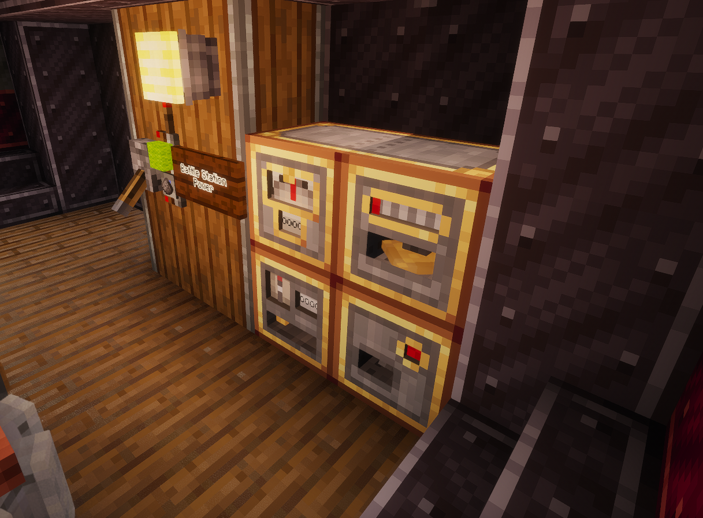

# Create Danger Close

**Create Danger Close** is an addon for Create, Create Simulated (Aeronautics) and Create Big Cannons, centered around pre-radar era gunnery.

## Contents

Create Danger Close (CDC) implements the following gameplay mechanics:

* Mechanical connectivity: no magical wireless linking. Simulated Sensors, computers and consoles require connection to a shared Create kinetic network through Battle Network Interfaces to work together.
* Modular multiblock Ballistic Computers: from simple static-target fire missions to ship combat with lead and attitude corrections, enabled by installing modules. The Differentiator leads moving targets, the Integrator keeps the solution running between readings, the Correlator merges several rangefinders and the Fuze Computer sets timed fuzes. Direct and plunging fire are both supported.
* Rangefinding: manned Rangefinder contraptions allow taking distance, bearing and rate measurements for accurate line-of-sight gunnery. On a ship, a Gimbal Sensor stabilizes the sight against pitch and roll, and a Navigation table with a Redstone magnet against yaw.
* Gun laying: Cannon Servos lay Big Cannons and Autocannons, keeping pace with moving targets. Turrets built on Swivel bearings are laid too, including chained bearings and several guns on one turret.
* Per-axis arc limits: Cannon mounts and Swivel bearings can be constrained to fire sectors, avoiding hitting your own structures.
* Gunnery stations: the Fire Mission Console sets the trajectory and fuze correction, and fires Big Cannons. The Autocannon Control Console lays and fires Autocannons, manually or automatically while the target is being ranged or marked on a map.
* Navigation Console: shows the ship's own attitude, speed and altitude.
* Multiblock Map tables: filled Maps can be placed on top, allowing target selection for BVR fire missions.
* Situational awareness and reconnaissance: players with a copy of a map displayed on a Map table will be shown as green arrows. Holding the map in the active hand will send terrain updates to the table, allowing fire corrections. Fire that would land near allies is held until confirmed.
* Kinetic Network Coupler: runs a separate kinetic network off another one's rotation, so several factory lines or battle networks can share one power source. It gears down when power is short, then decouples and overstresses its own side only.
* Damage and maintenance: explosions and shell hits jostle components out of alignment or break them, requiring repairs. Lenses gather dust over time, washed off by rain or a water bucket. Mechanisms use up their lubrication as they run, and may seize.
* Ponder scenes explain every block in game.

## Screenshots

*The corvette Tenax laying her gun to the rangefinder on the flying bridge.*

*Observing through the rangefinder.*

*Her ballistic computer below deck, with all modules required for naval combat.*

*Her gunnery station: Fire mission console and Map table, showing the target and fire sector.*

## Usage

This addon is best used for PvP multiplayer combat: just like IRL, effective gunnery requires coordination and cooperation. CDC aims to preserve the fun while avoiding the tedium.

## Dependencies

<a href="https://www.curseforge.com/minecraft/mc-mods/create" rel="nofollow">Create</a>, <a href="https://www.curseforge.com/minecraft/mc-mods/create-big-cannons" rel="nofollow">Create Big Cannons</a> and <a href="https://www.curseforge.com/minecraft/mc-mods/create-aeronautics" rel="nofollow">Create Aeronautics</a> are all required. Of the Create Aeronautics bundle, CDC uses its core (Simulated) and its ship engine (Sable).

## License

The code is licensed under the MIT License. The assets (textures, models and other art) are All Rights Reserved. See [LICENSE.md](LICENSE.md) for details.

## Issues

Please report any issues you find on the mod's <a href="[https://www.curseforge.com/minecraft/mc-mods/create](https://github.com/Daniel366Cobra/Create-Danger-Close/issuesGitHub)" rel="nofollow">Github</a>.