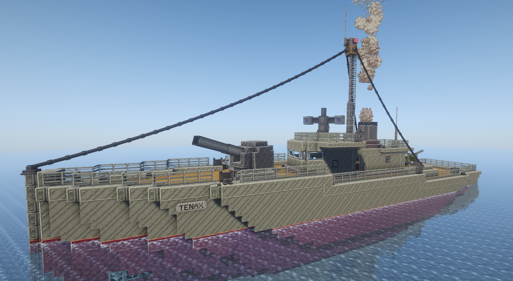
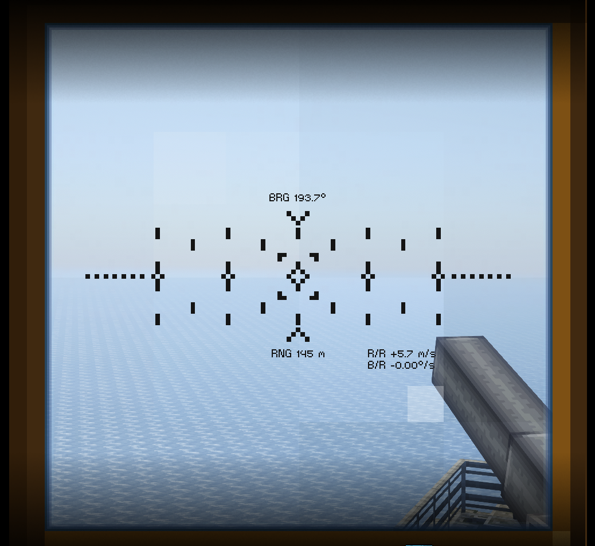
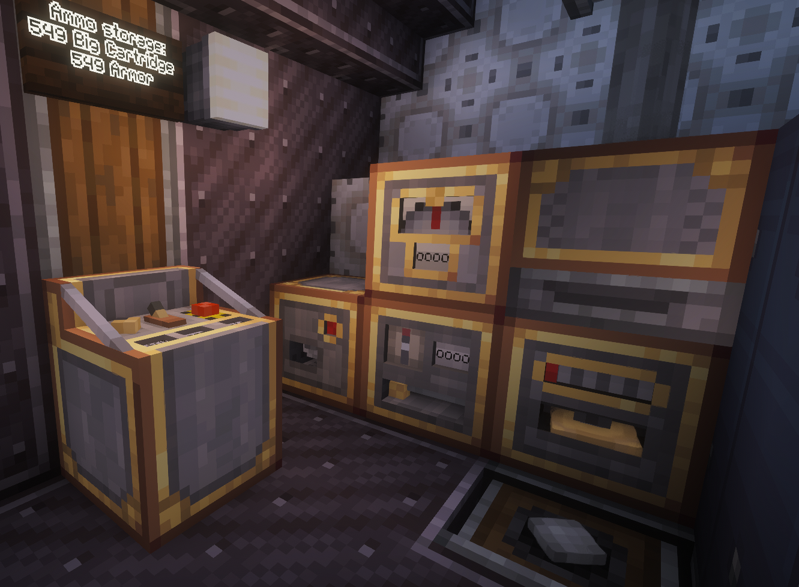

# Create Danger Close

**Create Danger Close** is an addon for Create, Create Simulated (Aeronautics) and Create Big Cannons, centered around pre-radar era gunnery.

## Contents

Create Danger Close (CDC) implements the following gameplay mechanics:

* Mechanical connectivity: no magical wireless linking. All components require connection to a shared Create kinetic network (Battle Network) to see each other and work together. Sensors (Gimbal, Velocity and Altitude Sensors, Navigation Tables) join it through Battle Network Interfaces.
* Modular multiblock Ballistic Computers: from simple static-target fire missions to ship combat with lead and attitude corrections, enabled by installing modules. The Differentiator leads moving targets, the Integrator keeps the solution running between readings, the Correlator merges several rangefinders and the Fuze Computer sets timed fuzes. Direct and plunging fire are both supported.
* Rangefinding: manned Rangefinder contraptions allow taking distance, bearing and rate measurements for accurate line-of-sight firing. Hold the sight steady to converge the markers; on a ship, a Gimbal Sensor stabilizes the sight against pitch and roll, and a heading sensor against yaw.
* Gun laying: Cannon Servos lay Create Big Cannons mounts onto the computer's solution, keeping pace with moving targets. Turrets built on Simulated swivel bearings are laid too, including chained bearings, several guns on one turret and per-axis arc limits.
* Fire control stations: the Fire Mission Console sets the trajectory and fuze correction and fires a salvo from every gun on target, while guns still training hold their fire. The Navigation Console shows the ship's own attitude, speed and altitude.
* Autocannons: the Autocannon Control Console lays the autocannons and fires them while the trigger is held, or by themselves in AUTO (weapons free) while a target is being ranged or marked on a map. Rounds are fuzed to the tick.
* Multiblock Map tables: filled Maps can be placed on top, allowing target selection for BVR fire missions.
* Friendly fire avoidance and situational awareness: players with a copy of a map displayed on a Map table will be shown as green arrows. Holding the map in the active hand will additionally send terrain updates to the table, so the fire control officer sees where the shells land. Fire that would land near your own side is held until confirmed (danger close).
* Kinetic Network Coupler: runs a separate kinetic network off another one's rotation, so a factory or a second battle network can share one engine. It gears down when power is short, then overstresses its own side only.
* Damage and maintenance: explosions and shell hits jostle components out of alignment (realign with a wrench) or break them (repair with cogwheels, precision mechanisms or glass panes). Lenses gather dust over time, washed off by rain or a water bucket. Mechanisms use up their lubrication as they run and may seize; top them up with honeycomb, or pipe in spindle oil.
* Ponder scenes explain every block in game.

## Screenshots

*The corvette Tenax laying her gun to the rangefinder on the flying bridge.*

*Through the rangefinder: bearing, range, range rate and bearing rate.*

*The gunnery station below deck: a Fire Mission Console beside a Ballistic Computer and its modules.*

## Usage

This addon is best used for PvP multiplayer combat: just like in real life, effective gunnery requires coordination and cooperation. CDC aims to preserve the thrill of it while avoiding the tedium.

## Dependencies

<a href="https://www.curseforge.com/minecraft/mc-mods/create" rel="nofollow">Create</a>, <a href="https://www.curseforge.com/minecraft/mc-mods/create-big-cannons" rel="nofollow">Create Big Cannons</a> and <a href="https://www.curseforge.com/minecraft/mc-mods/create-aeronautics" rel="nofollow">Create Aeronautics</a> are all required. Of the Create Aeronautics bundle, CDC uses its core (Simulated) and its ship engine (Sable).

## License

The code is licensed under the MIT License. The assets (textures, models and other art) are All Rights Reserved. See [LICENSE.md](LICENSE.md) for details.